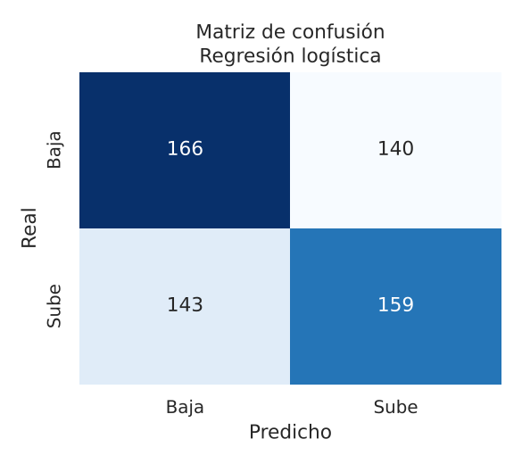
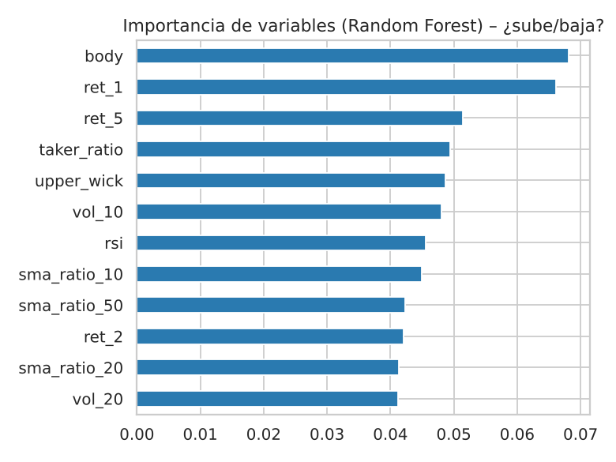
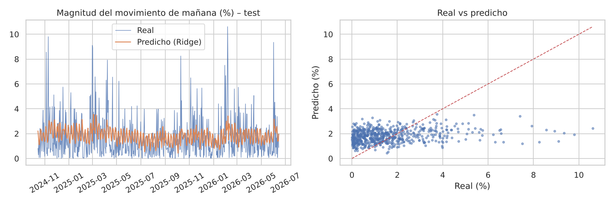
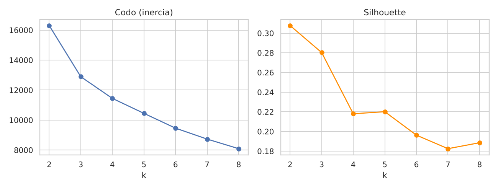
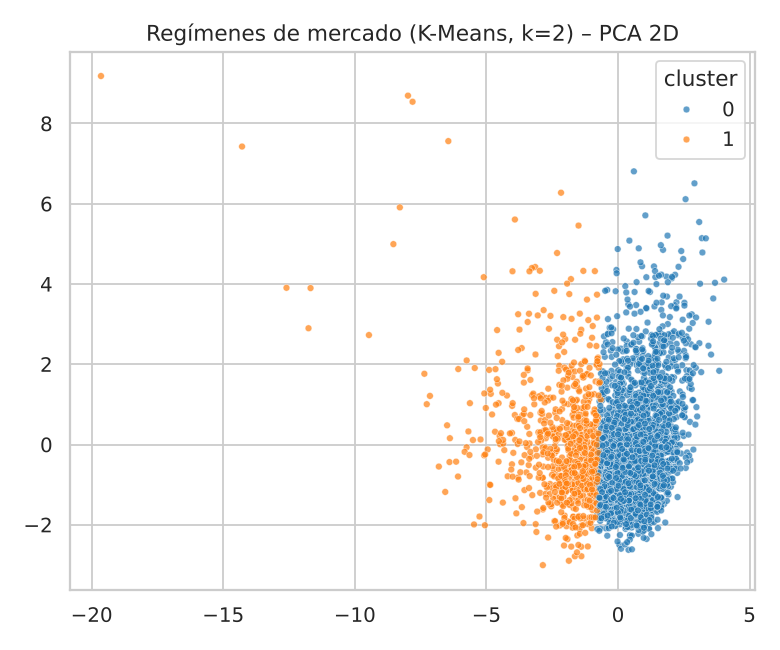
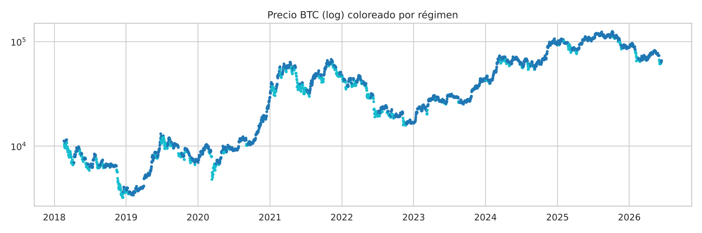
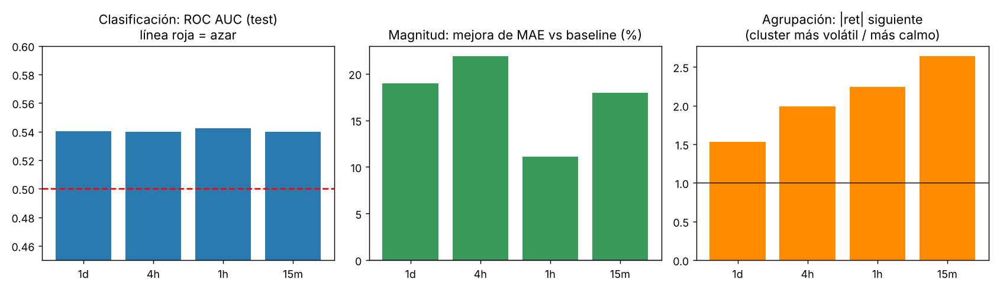

# Laboratorio: Predicción de Bitcoin — Clasificación, Regresión y Agrupación

Uso del histórico diario de Bitcoin (Binance, 2018–2026) para entrenar modelos que intentan responder:

1. **Clasificación:** ¿mañana el precio sube o baja?
2. **Regresión:** ¿qué tan grande será el movimiento de mañana?
3. **Agrupación:** ¿existen regímenes de mercado distinguibles?

Dataset: [Bitcoin Historical Datasets 2018-2024 (Kaggle, novandraanugrah)](https://www.kaggle.com/datasets/novandraanugrah/bitcoin-historical-datasets-2018-2024), archivo `btc_1d_data_2018_to_2025.csv`.

---

## 1. Estructura del proyecto

```
btc_lab/
├── lab_btc.py            # CLI: lee argumentos y llama a btc_lab.pipeline
├── btc_lab/              # paquete (una responsabilidad por módulo)
│   ├── config.py         # parámetros de la corrida
│   ├── domain.py         # contratos CandleSource y FeatureBuilder
│   ├── pipeline.py       # orquesta la corrida; no calcula features ni entrena
│   ├── data/             # fuentes de velas, limpieza y corte temporal
│   ├── features/         # indicadores y variables técnicas
│   ├── models/           # catálogo de clasificadores y regresores
│   ├── tasks/            # clasificación, regresión, agrupación, pronóstico
│   └── reporting/        # gráficos
├── compare_freqs.py      # Compara las 4 resoluciones (1d, 4h, 1h, 15m)
├── run_all.sh            # Ejecuta todo de punta a punta
├── requirements.txt
├── setup.sh / setup.ps1  # Creación del venv
├── data/                 # CSV de Kaggle: 1d, 4h, 1h, 15m
├── resultados/
│   ├── 1d/ 4h/ 1h/ 15m/  # métricas (CSV), gráficos (PNG), pronóstico (JSON) y log por resolución
│   └── comparacion_resoluciones.(csv|png)
└── README.md
```

El comando no cambia. El paquete separa carga, variables, modelos y tareas para poder agregar un modelo o una fuente de datos registrándolo, sin reescribir el pipeline.

## 2. Reproducir

```bash
# Linux / macOS / WSL                      # Windows PowerShell
./setup.sh && source .venv/bin/activate    .\setup.ps1

python lab_btc.py --data data/btc_1d_data_2018_to_2025.csv   # solo el diario (secciones 3-9)
./run_all.sh                                                  # las 4 resoluciones + comparación (sección 10)
```

Las secciones 3 a 9 corresponden a la resolución **diaria**. El log de cada ejecución está en `resultados/<resolución>/salida_consola.txt`.

## 3. Datos y preparación

- **3 089 velas diarias** (2018-01-01 → 2026-06-16). La última (2026-06-16) estaba incompleta (volumen muy inferior al habitual) y se descartó automáticamente: quedan **3 088 días** (hasta 2026-06-15).
- Sin valores nulos ni fechas duplicadas.
- **Variables (todas calculadas solo con información pasada):** retornos logarítmicos a 1, 2, 5, 10 y 20 días; volatilidad móvil (5, 10, 20 días); razón precio/media móvil (10, 20, 50); RSI(14); histograma MACD; %B de Bollinger; rango diario, cuerpo y mechas de la vela; cambio y z-score del volumen; cambio en número de operaciones; proporción de volumen comprador (*taker*); día de la semana (seno/coseno).
- **Targets (lo que pasa mañana):** `y_up` (1 si el retorno de mañana > 0), `next_ret` (retorno logarítmico con signo) y `next_abs` (magnitud |retorno|).
- **División temporal, sin mezclar:** 80 % entrenamiento (2018-02-19 → 2024-10-14, 2 430 días) y 20 % prueba (2024-10-15 → 2026-06-14, 608 días). Validación cruzada con `TimeSeriesSplit` (5 pliegues). Un split aleatorio filtraría información del futuro.
- % de días alcistas: 51,1 % en entrenamiento y 49,7 % en prueba.

---

## 4. Clasificación: ¿sube o baja mañana?

Modelos: baseline (clase mayoritaria), regresión logística, Random Forest y Gradient Boosting.

| Modelo | Accuracy | Balanced acc. | F1 | ROC AUC (test) | ROC AUC (CV train) |
|---|---|---|---|---|---|
| Baseline (mayoría) | 0.4967 | 0.5000 | 0.6637 | 0.5000 | 0.5000 |
| **Regresión logística** | **0.5345** | **0.5345** | 0.5291 | **0.5404** | 0.5251 |
| Random Forest | 0.4819 | 0.4821 | 0.4960 | 0.4942 | 0.5496 |
| Gradient Boosting | 0.4901 | 0.4894 | 0.4238 | 0.5072 | 0.5331 |

| Matriz de confusión (mejor modelo) | Importancia de variables (Random Forest) |
|---|---|
|  |  |

Métricas en `resultados/1d/clasificacion_metricas.csv`.

**Lectura.** La regresión logística es el único modelo que supera ligeramente al azar (accuracy 53,4 %, AUC 0,54). Random Forest y Gradient Boosting rinden mejor en validación cruzada que en prueba y terminan en torno a 0,50 en el periodo final: señal de sobreajuste a patrones que no se sostienen. El F1 alto del baseline (0,66) es engañoso: solo refleja que predice siempre "sube", y su accuracy es la de una moneda.

## 5. Regresión: ¿qué tan grande es el movimiento?

Se entrenaron dos regresiones por separado.

### 5.1 Retorno con signo (`next_ret`)

| Modelo | MAE % | RMSE % | R² | Acierto de dirección |
|---|---|---|---|---|
| Baseline (media train) | 1.6485 | 2.3271 | -0.0011 | 0.4967 |
| Ridge | 1.6900 | 2.3538 | -0.0242 | 0.5016 |
| Random Forest | 1.7038 | 2.3733 | -0.0412 | 0.5066 |
| Gradient Boosting | 1.7812 | 2.4651 | -0.1233 | 0.5082 |

Ningún modelo mejora al baseline: el R² es negativo y la dirección acierta alrededor del 50 %. **El retorno diario con signo no es predecible con estas variables.**

### 5.2 Magnitud del movimiento (`next_abs`)

| Modelo | MAE % | RMSE % | R² |
|---|---|---|---|
| Baseline (media train) | 1.4877 | 1.7867 | -0.1837 |
| **Ridge** | **1.2059** | **1.6177** | **0.0297** |
| Random Forest | 1.2364 | 1.6210 | 0.0257 |
| Gradient Boosting | 1.3715 | 1.7825 | -0.1782 |



Métricas en `resultados/1d/regresion_next_ret_metricas.csv` y `resultados/1d/regresion_next_abs_metricas.csv`.

**Lectura.** Aquí sí hay señal: Ridge reduce el MAE de 1,49 % a 1,21 % (≈19 % menos error) frente al baseline. El R² es pequeño (0,03), así que el modelo capta el *nivel* de volatilidad esperado pero no los picos extremos, como se ve en el gráfico (las predicciones se mueven en 1–3 %, mientras los saltos reales llegan al 10 %). Parte de la ventaja sobre el baseline se debe a que la volatilidad del periodo de prueba fue menor que la del entrenamiento (por eso el baseline tiene R² negativo): conviene leer la mejora con cautela.

## 6. Agrupación: regímenes de mercado (K-Means)

Variables usadas (estandarizadas, **sin el target**): `ret_5`, `vol_10`, `vol_20`, `range`, `vol_z`, `sma_ratio_20`, `rsi`. El número de clusters se eligió por silhouette (k = 2, silhouette = 0,308).

| Elección de k | Clusters en PCA 2D |
|---|---|
|  |  |



| Cluster | Días | ret_5 | vol_20 | Rango | RSI | Prom. \|ret\| de mañana | % días que suben mañana |
|---|---|---|---|---|---|---|---|
| 0 — Calma / tendencia alcista | 2 272 | +2,5 % | 2,6 % | 3,5 % | 56,2 | 1,95 % | 49,6 % |
| 1 — Estrés / caída volátil | 766 | -6,3 % | 4,2 % | 7,3 % | 38,9 | 2,99 % | 54,3 % |

Perfiles completos en `resultados/1d/agrupacion_perfiles.csv`.

**Lectura.** K-Means separa dos regímenes claros: mercado tranquilo con tendencia positiva (74 % de los días) y mercado estresado, con caídas y alta volatilidad (26 %). Lo relevante es que el régimen **sí anticipa el riesgo**: tras un día del cluster 1, el movimiento esperado del día siguiente es ~53 % mayor (2,99 % vs 1,95 %). En cambio **no separa la dirección** (49,6 % vs 54,3 % de días alcistas, una diferencia modesta y sin garantía de ser estable). Esto es coherente con los resultados de regresión: la magnitud es parcialmente predecible; la dirección, no.

## 7. Pronóstico para el día siguiente

Reentrenando los mejores modelos con todo el histórico válido (`resultados/1d/pronostico_manana.json`):

| Dato base | Prob. de que suba (reg. logística) | Movimiento esperado (Ridge) |
|---|---|---|
| 2026-06-15 | 47,0 % | ≈ ±2,17 % |

Es una probabilidad cercana a 50 %, coherente con la baja capacidad predictiva de la clasificación. No debe usarse como señal de inversión.

## 8. Conclusiones

1. **La dirección diaria de Bitcoin es prácticamente impredecible** con indicadores técnicos y de volumen: el mejor clasificador logra 53,4 % de accuracy y AUC 0,54, apenas sobre el azar, y los modelos más complejos no generalizan.
2. **La magnitud del movimiento sí es parcialmente predecible**, por el agrupamiento de volatilidad (días volátiles tienden a seguir a días volátiles). Ridge mejora al baseline en un ~19 % de MAE, aunque con R² bajo.
3. **Los regímenes de mercado descubiertos por K-Means capturan riesgo, no dirección:** el cluster de estrés duplica casi la volatilidad y anticipa movimientos mayores.
4. Los modelos simples (regresión logística, Ridge) rindieron igual o mejor que los de árboles: con datos tan ruidosos, la complejidad adicional se paga en sobreajuste.

## 9. Limitaciones y trabajo futuro

- Un solo activo y un solo periodo de prueba (608 días), con un ciclo de mercado particular; las métricas tienen incertidumbre y no se aplicó una prueba de significancia.
- No se incluyen costos de transacción ni una estrategia de trading; que un modelo acierte 53 % no implica rentabilidad.
- Se usaron hiperparámetros fijos, sin búsqueda en malla.
- Ideas: `GridSearchCV` con `TimeSeriesSplit`, modelos de volatilidad (GARCH/HAR), añadir el cluster como variable del clasificador, variables externas (macro, sentimiento) y evaluación con *walk-forward* y costos de transacción.

---

## 10. Comparación por resolución temporal (1d, 4h, 1h, 15m)

El mismo pipeline se ejecutó sobre las cuatro resoluciones. En las intradía el objetivo es la **siguiente vela** (no el día siguiente), las ventanas de las variables se cuentan en velas y se agregan la hora del día (seno/coseno) como variables. Resultados en `resultados/comparacion_resoluciones.csv`.

| Resolución | Mejor clasificador | Accuracy (baseline) | ROC AUC test | Mejor regresor de magnitud | MAE % (baseline) | Mejora MAE | R² magnitud | Ratio de riesgo entre clusters* |
|---|---|---|---|---|---|---|---|---|
| 1d | Reg. logística | 0.535 (0.497) | 0.540 | Ridge | 1.206 (1.488) | 18.9 % | 0.030 | 1.53× |
| 4h | Random Forest | 0.522 (0.507) | 0.540 | Random Forest | 0.468 (0.600) | 21.9 % | 0.111 | 1.99× |
| 1h | Gradient Boosting | 0.530 (0.504) | 0.542 | Gradient Boosting | 0.216 (0.243) | 11.1 % | 0.155 | 2.24× |
| 15m | Random Forest | 0.528 (0.499) | 0.540 | Ridge | 0.107 (0.130) | 17.9 % | 0.207 | 2.64× |

\* Cociente entre el |retorno| medio de la siguiente vela en el cluster más volátil y en el más calmo.



**Lectura.**

1. **La dirección sigue siendo casi impredecible en todas las resoluciones:** el ROC AUC se queda en 0,54 y la accuracy entre 52 y 53,5 %. Pasar a datos más finos no crea una señal direccional más fuerte. Con muestras de prueba grandes (59 mil velas en 15m) una AUC de 0,54 es estadísticamente distinta de 0,5, pero es una ventaja mínima que no sobrevive a comisiones y *slippage*.
2. **La magnitud es la parte predecible, y el R² mejora al bajar de resolución** (0,03 → 0,11 → 0,16 → 0,21): a escalas cortas el agrupamiento de volatilidad es más marcado y más estable (también los clusters separan mejor el riesgo: 1,5× en diario frente a 2,6× en 15m). La mejora relativa del MAE sobre el baseline es de 11–22 % en todas.
3. **Las cifras de resoluciones distintas no son comparables en valor absoluto:** el MAE de 15m (0,11 %) es pequeño porque predice un movimiento de 15 minutos, no uno de un día. Lo comparable es la mejora relativa y el R².

**Limpieza de datos.** Los CSV de 4h, 1h y 15m traen 2 velas duplicadas con precios corruptos (~108 000 USD el 6–7 de julio de 2018, cuando BTC valía ~6 500 USD). `lab_btc.py` detecta los timestamps repetidos y conserva la vela coherente con sus vecinas. Sin esta limpieza el K-Means aislaba esas filas como un "cluster" propio y las métricas de regresión salían distorsionadas. El CSV diario no tiene el problema. Los archivos intradía también tienen algunos huecos (hasta ~1,4 días en febrero de 2018) y unas pocas velas con volumen cero, que no se alteraron.

**Diferencias de configuración entre resoluciones (para ser justos con la comparación):**

- **Ventana de entrenamiento:** en 1h y 15m se usan solo las **20 000 velas de entrenamiento más recientes** para acotar el tiempo de cómputo. En 1h eso cubre 2022-06 → 2024-10 y en 15m solo 2024-03 → 2024-10 (~6 meses), mientras que en 1d y 4h se usa todo el histórico de entrenamiento. El tramo de prueba es el mismo en todas (desde oct-2024).
- **Modelos más ligeros en 1h y 15m** (`--fast`: 100 árboles en Random Forest y 80 en Gradient Boosting, en lugar de 300 y 150).
- Por tanto, los resultados de 1h y 15m son una cota prudente: con más datos de entrenamiento y modelos completos podrían cambiar.
